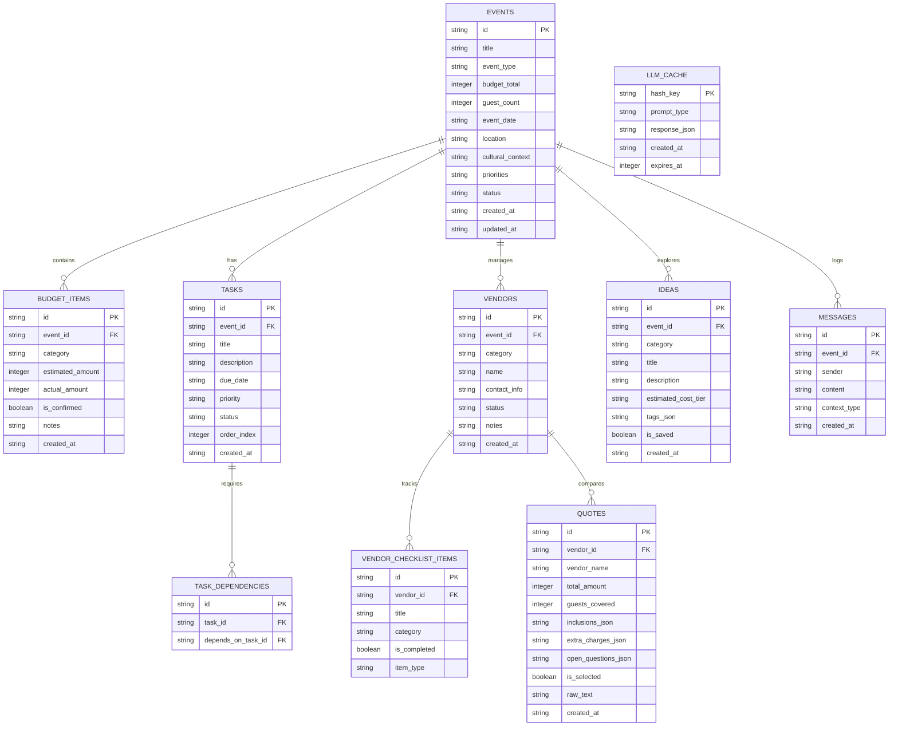

# DESIGN SPECIFICATION: GenAI Event Planning Assistant

> **Official Problem Statement:**  
> "Create a GenAI-powered planning assistant that helps users organize weddings, birthdays, and community events with budgets, timelines, vendor checklists, and personalized ideas."

---

## 1. User Personas

### Persona 1: Wedding Planner (Individual / Family)
- **Name:** Priya & Rohan Sharma
- **Location:** Bengaluru / Jaipur, India
- **Event:** Traditional 3-day Indian Wedding (Sangeet, Mehendi, Pheras & Reception)
- **Guest Count:** 350 guests
- **Budget:** ₹25,00,000 (25 Lakhs INR)
- **Most Stressful Problem:**  
  *Vendor dependency cascades and budget creep.* In multi-day weddings, booking the venue dictates decor, catering minimum guest guarantees, and photographer schedules. When catering per-plate costs exceed expectations or 50 additional relatives RSVP, they need to know exactly which discretionary budgets (e.g. exotic floral decor or luxury favors) to trim without ruining core traditions or timeline commitments.

### Persona 2: Birthday Organizer (Parent)
- **Name:** Anita Desai
- **Location:** Pune, India
- **Event:** Milestone 10th Birthday & Grandparents' Gathering (Intergenerational)
- **Guest Count:** 45 guests (20 kids, 15 adults, 10 senior citizens)
- **Budget:** ₹75,000 INR
- **Most Stressful Problem:**  
  *Balancing diverse age-group entertainment and dietary preferences within a tight fixed budget.* Anita struggles to find activities that keep energetic 10-year-olds engaged without overwhelming grandparents with loud music, while managing quote comparisons from magicians, bakers, and banquet halls without getting hit by hidden fees.

### Persona 3: Community Event Organizer (RWA Secretary / Volunteer Lead)
- **Name:** Vikram Sengupta
- **Location:** Kolkata, India
- **Event:** Green Valley Society Diwali Mela & Cultural Evening
- **Guest Count:** 500 residents
- **Budget:** ₹3,50,000 INR (funded by society contributions & stall fees)
- **Most Stressful Problem:**  
  *Volunteer coordination, permit dependencies, and rigid milestone deadlines.* Vikram is coordinating part-time volunteers. If municipal fire/sound permits are delayed by a week, stage sound setup and food stall inspections are paralyzed. He needs clear dependency-tracked checklists and actionable vendor quote comparison for stage lights and security guards.

---

## 2. Core User Flows

### Flow 1: Guided Intake & Plan Initialization
```
[User Selects Occasion: Wedding / Birthday / Community]
                        │
                        ▼
[Conversational Intake: Questions on Budget, Guests, Date, Location, Preferences, Priorities]
                        │
                        ▼
[AI Generates Baseline Plan: Budget Breakdown + Backward Timeline + Vendor Categories + Personalized Ideas]
                        │
                        ▼
[System Stores Plan in SQLite & Opens Event Dashboard]
```

### Flow 2: Dynamic Budget Allocation & Tracking
```
[User views AI Recommended Allocations with Reasoning]
                        │
                        ▼
[User Adjusts Allocated Amount or Adds Actual Expense]
                        │
                        ▼
[Deterministic Engine Recalculates: Total Spent, Remaining Budget, Per-Guest Cost, Variance]
                        │
                        ▼
[If Over-Budget: Alert triggered + AI Suggests Specific Trade-offs (Never silent arbitrary cuts)]
```

### Flow 3: Dependency-Aware Timeline Execution
```
[User views Tasks ordered backward from Event Date (T-120 days, T-60 days, etc.)]
                        │
                        ▼
[User marks Task as 'Done' or 'Delayed' (+X days)]
                        │
                        ▼
[Deterministic Engine checks task_dependencies table & cascades deadline shifts]
                        │
                        ▼
[Dashboard highlights 'Next 3 Urgent Tasks' and 'Days Remaining']
```

### Flow 4: Vendor Checklist & Structured Quote Comparison
```
[User selects Vendor Category (e.g., Catering / Photography / Sound)]
                        │
                        ▼
[System presents: Must-have specifications, Questions to ask vendor, Document checklist]
                        │
                        ▼
[User pastes unstructured vendor quotation text / enters rates]
                        │
                        ▼
[AI extracts structured comparison: Inclusions, Guest limits, Extra hidden charges, Open questions]
                        │
                        ▼
[Comparison matrix rendered with budget fit indicator; User confirms selection]
```

### Flow 5: Personalized Ideas Exploration & Chat Refinement
```
[User explores AI Suggestions for Themes, Decor, Food & Beverage, Entertainment, Activities]
                        │
                        ▼
[User refines via prompt: "Make it kid & senior friendly" or "Cheaper alternative for decor"]
                        │
                        ▼
[AI provides customized, budget-conscious alternatives with actionable implementation steps]
```

### Flow 6: Plan Revision / Change Handling (Re-planning without restarting)
```
[User submits change: "+50 guests, ₹2L lower budget, 2 weeks earlier date"]
                        │
                        ▼
[Engine compares Current Plan vs New Constraints]
                        │
                        ▼
[AI generates 2-3 structured trade-off options with concrete consequences and visual diff]
  ├─ Option A: Moderate scale-down (trim decor & favors, maintain core menu)
  ├─ Option B: Shift to buffet/finger food format, fast-track vendor bookings
  └─ Option C: Re-negotiate venue hall size and simplify stage production
                        │
                        ▼
[User selects an Option -> Plan is updated in-place preserving confirmed items and history]
```

---

## 3. ASCII Wireframes

### Screen 1: Overview (Dashboard)
```
+-------------------------------------------------------------------------------+
|  PLANWARS AI | [Plan: Sharma Wedding]  [Date: 15/12/2026]  [Guests: 350]     |
+-------------------------------------------------------------------------------+
| [Overview]   [Budget]   [Timeline]   [Vendors]   [Ideas]   [AI Assistant]    |
+-------------------------------------------------------------------------------+
|                                                                               |
|  +------------------------+  +------------------------+  +------------------+ |
|  | TOTAL BUDGET           |  | CONFIRMED EXPENSES     |  | REMAINING BUDGET | |
|  | ₹25,00,000             |  | ₹14,20,000             |  | ₹10,80,000       | |
|  | 350 Guests (₹7,143/gst)|  | 56.8% Allocated        |  | Status: HEALTHY  | |
|  +------------------------+  +------------------------+  +------------------+ |
|                                                                               |
|  +---------------------------------------------+  +-------------------------+ |
|  | NEXT 3 URGENT TASKS (Days to Event: 47)     |  | PLAN HEALTH & ALERTS    | |
|  | [!] Finalize Catering Menu (Due: in 3 days) |  | [OK] Venue locked       | |
|  | [ ] Send Physical Invitations (in 7 days)   |  | [!] 2 quotes pending    | |
|  | [ ] Photographer Shot-list (in 12 days)     |  | [i] AI Estimate Active  | |
|  +---------------------------------------------+  +-------------------------+ |
|                                                                               |
|  QUICK REPLAN BAR:                                                            |
|  [ Need to change guests, budget, or date? Click here to Revise Plan ]        |
+-------------------------------------------------------------------------------+
```

### Screen 2: Budget Breakdown & Allocation
```
+-------------------------------------------------------------------------------+
| BUDGET MANAGEMENT                           [+ Add Custom Category] [Re-plan] |
+-------------------------------------------------------------------------------+
| Summary: Allocated ₹23,50,000 / ₹25,00,000  |  Unallocated: ₹1,50,000         |
| [======================================------] 94% Allocated                  |
+-------------------------------------------------------------------------------+
| Category     | AI Estimate* | Actual Cost | Status     | Actions              |
+--------------+--------------+-------------+------------+----------------------+
| Venue & Stay | ₹10,00,000   | ₹10,50,000  | [Confirmed]| [Edit] [Delete]      |
| Catering     | ₹7,00,000    | ₹6,80,000   | [Confirmed]| [Edit] [Delete]      |
| Decor        | ₹3,50,000    | --          | [Estimate*]| [Enter Actual] [Edit]|
| Photography  | ₹2,00,000    | ₹2,10,000   | [Confirmed]| [Edit] [Delete]      |
| Music/Sound  | ₹1,00,000    | --          | [Estimate*]| [Enter Actual] [Edit]|
+-------------------------------------------------------------------------------+
| *Note: Items labeled [Estimate*] are AI benchmarks based on 350 guests.       |
| Actual commitments are confirmed by you.                                      |
+-------------------------------------------------------------------------------+
```

### Screen 3: Timeline & Dependency Graph
```
+-------------------------------------------------------------------------------+
| TIMELINE (Working backwards from 15/12/2026)             [+ Add Task] [Filter]|
+-------------------------------------------------------------------------------+
| Phase: T-120 Days to T-90 Days (Milestone: Core Bookings)                     |
|  [x] Book Primary Venue                   Due: 15/08/2026   [Dependencies: 0] |
|  [x] Lock Catering Contract               Due: 25/08/2026   [Dep: Venue]      |
|                                                                               |
| Phase: T-60 Days to T-30 Days (Milestone: Details & Invitations)              |
|  [!] Finalize Menu & Tasting              Due: 02/11/2026   [Dep: Catering]   |
|      Status: In Progress   [Mark Done] [Delay +7 Days]                        |
|  [ ] Print & Dispatch Invites             Due: 10/11/2026   [Dep: Venue]      |
|                                                                               |
| Phase: T-15 Days to Event Day (Milestone: Final Coordination)                 |
|  [ ] Rehearse Sound & Stage Setup         Due: 12/12/2026   [Dep: Menu, Decor]|
+-------------------------------------------------------------------------------+
| Re-dating rule: If a dependency is delayed, downstream tasks auto-flag.       |
+-------------------------------------------------------------------------------+
```

### Screen 4: Vendors & Quote Comparison
```
+-------------------------------------------------------------------------------+
| VENDOR CHECKLIST & QUOTE COMPARISON                      [+ Add Vendor Type]  |
+-------------------------------------------------------------------------------+
| Categories: [Catering (2 quotes)] [Decor] [Sound & Lights] [Photography]     |
|                                                                               |
| Catering Requirements & Questions:                                            |
|  [v] Live counter power requirements verified                                 |
|  [ ] Per-plate tasting completed                                              |
|  [ ] Overtime penalty clause checked                                          |
|                                                                               |
| QUOTE COMPARISON MATRIX (Catering):                                           |
| Feature/Clause         | Vendor A (Royal Feast)   | Vendor B (Spice Symphony)  |
| -----------------------+--------------------------+---------------------------|
| Quoted Amount          | ₹6,80,000 (₹1,942/guest) | ₹7,20,000 (₹2,057/guest)  |
| Inclusions             | 4 Starters, 6 Mains, Live| 6 Starters, 8 Mains, Chai |
| Extra Charges Noted    | ₹15,000 generator charge | ₹8,000 waste disposal fee |
| Open Questions for You | Is mineral water extra?  | Staff gratuity included?  |
| AI Budget Assessment   | Within catering budget   | +₹20,000 over estimate    |
| Action                 | [Select This Quote]      | [Select This Quote]       |
|                                                                               |
| [ Paste New Quote Text to Extract Comparison ]                                |
+-------------------------------------------------------------------------------+
```

### Screen 5: Personalized Ideas & Interactive Refinement
```
+-------------------------------------------------------------------------------+
| PERSONALIZED IDEAS & INSPIRATION                   [Filter: Kids / Seniors]   |
+-------------------------------------------------------------------------------+
| Culture: South-North Fusion | Atmosphere: Joyful & Elegant | Budget: Balanced |
|                                                                               |
| [Theme: Marigold Twilight]                                                    |
| AI Idea: Sustainable floral decor using locally sourced marigolds and clay    |
| diyas. Cost rating: ₹₹ (Affordable). Kid-safe LED perimeter lighting.        |
| [Save to Plan]  [Ask AI for Cheaper Alternative]                              |
|                                                                               |
| [Activity: Interactive Photo-Scavenger Hunt]                                  |
| AI Idea: Mixed-generation trivia cards at dinner tables. Engages elders &     |
| youth alike. Zero rental cost.                                                |
| [Save to Plan]  [Ask AI to Customize]                                         |
|                                                                               |
| Refine Ideas Chat:                                                            |
| User: "Suggest low-sugar dessert alternatives for elderly guests"             |
| AI: "Here are 3 Indian fusion desserts using jaggery & almond milk: ..."     |
+-------------------------------------------------------------------------------+
```

### Screen 6: Re-plan / Change Management Modal
```
+-------------------------------------------------------------------------------+
| REVISE EVENT PLAN (Current: 350 guests, ₹25L budget, 15/12/2026)             |
+-------------------------------------------------------------------------------+
| What changed?                                                                 |
| New Guest Count: [ 400 ]  (+50 guests)                                        |
| New Budget:      [ ₹23,00,000 ]  (-₹2,00,000)                                 |
| New Event Date:  [ 01/12/2026 ]  (14 days earlier)                            |
+-------------------------------------------------------------------------------+
| AI EVALUATION OF TRADE-OFFS:                                                  |
|                                                                               |
| OPTION 1: "Menu & Favor Optimization"                                         |
| - Impact: Compress food courses from 6 to 4; replace luxury gift boxes.       |
| - Timeline Impact: Venue & caterer must lock in 48 hours.                     |
| - Budget Variance: Stays at ₹23,00,000 exactly.                               |
| [Choose Option 1]                                                             |
|                                                                               |
| OPTION 2: "Decor & Entertainment Rationalization"                             |
| - Impact: Keep full menu for 400; replace live band with curated DJ playlist.  |
| - Timeline Impact: Fast-track sound permits by 10 days.                       |
| - Budget Variance: Saves ₹2,20,000 (leaves ₹20,000 buffer).                   |
| [Choose Option 2]                                                             |
+-------------------------------------------------------------------------------+
```

---

## 4. SQLite Data Model



---

## 5. API Specification

| Method | Endpoint | Description | Request Body | Response |
|---|---|---|---|---|
| `GET` | `/api/health` | Healthcheck & system status | None | `{ status: "ok", timestamp }` |
| `POST` | `/api/intake/chat` | Conversational intake query | `{ eventId?, message, partialData }` | `{ reply, missingFields, readyToGenerate, planPreview }` |
| `POST` | `/api/events` | Create new event from intake | `{ title, eventType, budgetTotal, guestCount, eventDate, ... }` | Full created event object |
| `GET` | `/api/events` | List all events (paginated) | Query params `page`, `limit` | `{ events: [], total, page }` |
| `GET` | `/api/events/:id` | Get full event plan with summary | None | `{ event, budget, tasks, vendors, ideas, stats }` |
| `PATCH` | `/api/events/:id` | Update event metadata | Partial event fields | Updated event |
| `DELETE` | `/api/events/:id` | Delete an event | None | `{ success: true }` |
| `GET` | `/api/events/:id/budget` | Get budget items & deterministic stats | None | `{ items: [], totalBudget, allocated, remaining, perGuest }` |
| `POST` | `/api/events/:id/budget` | Add or update budget item | `{ category, estimatedAmount, actualAmount, isConfirmed }` | Created budget item |
| `PATCH` | `/api/events/:id/budget/:itemId` | Edit budget item | `{ actualAmount, isConfirmed, estimatedAmount }` | Updated item |
| `DELETE` | `/api/events/:id/budget/:itemId` | Delete budget item | None | `{ success: true }` |
| `POST` | `/api/events/:id/budget/generate` | AI generates budget allocation | `{ overwrite? }` | `{ items: [], rationale }` |
| `GET` | `/api/events/:id/timeline` | Get tasks with dependencies & next 3 | None | `{ tasks: [], nextTasks: [], daysRemaining }` |
| `POST` | `/api/events/:id/timeline` | Add custom task | `{ title, dueDate, priority, dependsOnTaskIds }` | Created task |
| `PATCH` | `/api/events/:id/timeline/:taskId`| Update task status or delay | `{ status, delayDays }` | `{ task, cascadedTasks: [] }` |
| `POST` | `/api/events/:id/timeline/generate`| AI generates backward timeline | `{ overwrite? }` | `{ tasks: [] }` |
| `GET` | `/api/events/:id/vendors` | Get vendor categories & checklists | None | `{ vendors: [] }` |
| `POST` | `/api/events/:id/vendors` | Create vendor category / entry | `{ category, name }` | Created vendor |
| `POST` | `/api/events/:id/vendors/:vendorId/checklist` | Add checklist item | `{ title, itemType }` | Created item |
| `PATCH` | `/api/events/:id/vendors/checklist/:itemId` | Toggle checklist checkmark | `{ isCompleted }` | Updated item |
| `POST` | `/api/events/:id/vendors/:vendorId/quotes/compare` | Extract & compare quotes via LLM | `{ rawQuoteText, vendorName }` | `{ quote, comparisonWithBudget }` |
| `GET` | `/api/events/:id/ideas` | Get ideas filtered by category/age | Query `category`, `tag` | `{ ideas: [] }` |
| `POST` | `/api/events/:id/ideas/generate` | Generate personalized ideas | `{ focusArea, ageGroupMix }` | `{ ideas: [] }` |
| `POST` | `/api/events/:id/ideas/refine` | Chat to refine or find cheaper alt | `{ ideaId, instruction }` | `{ refinedIdea, alternatives: [] }` |
| `POST` | `/api/events/:id/replan/evaluate` | Evaluate change & get trade-off options | `{ guestCount, budgetTotal, eventDate }` | `{ options: [ { title, description, budgetDiff, timelineDiff, consequences } ] }` |
| `POST` | `/api/events/:id/replan/apply` | Apply selected trade-off option | `{ optionId, guestCount, budgetTotal, eventDate, allocations, taskAdjustments }` | `{ updatedEvent, budget, timeline }` |
| `POST` | `/api/events/:id/chat` | Context-aware event assistant | `{ message }` | `{ reply }` |

